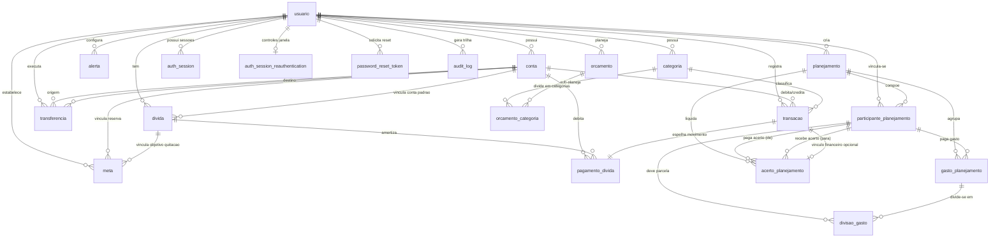

# Arquitetura e Especificação do Banco de Dados

Este documento é a referência canônica e abrangente do banco de dados relacional PostgreSQL do sistema de gestão financeira pessoal. Ele documenta a infraestrutura de persistência, catálogo de migrações, diagrama entidade-relacionamento (ERD), dicionário de dados completo e procedimentos operacionais.

---

## 1. Visão Geral da Persistência

- **SGBD**: PostgreSQL (compatível com PostgreSQL 15 e 16).
- **ORM / Mapeador**: TypeORM 0.3.x (operando com `synchronize: false`).
- **Evolução de Esquema**: Migrações SQL manuais, determinísticas e versionadas em `backendnest/migrations/`.
- **Estratégia de Conexão**: Centralizada em `backendnest/src/config/database.config.ts`, com validação estrita de TLS (`DB_SSL_MODE=verify-full` em produção e `disable` estritamente em desenvolvimento/testes locais).
- **Extensões Requeridas**: `pgcrypto` (para suporte a `gen_random_uuid()` e funções criptográficas nativas).

---

## 2. Convenções de Arquitetura e Decisões de Design

### 2.1. Identificadores e Chaves Primárias
Todas as tabelas do sistema utilizam **UUID** como chave primária (`id uuid PRIMARY KEY`). As chaves podem ser geradas pela aplicação (NestJS / `crypto.randomUUID()`) ou pelo PostgreSQL via `gen_random_uuid()`.

### 2.2. Representação Monetária (Dualidade de Tipos)
O sistema possui duas convenções de valores monetários que devem ser rigorosamente respeitadas:
1. **Núcleo Financeiro Tradicional** (`conta`, `transacao`, `transferencia`, `divida`, `meta`, `orcamento`, `orcamento_categoria`, `pagamento_divida`):
   - Usa `numeric(14,2)` ou `numeric(12,2)` para precisão monetária decimal.
   - A tabela `divida` usa `numeric(6,3)` para taxas de juros (`taxa_juros`).
2. **Planejamentos Compartilhados** (`gasto_planejamento`, `divisao_gasto`, `acerto_planejamento`):
   - Usa inteiros positivos em centavos (`integer`, ex: `valor_centavos`, `valor_devido_centavos`) para simplificar partições inteiras e evitar erros de ponto flutuante em acertos entre participantes.

### 2.3. Saldo Atual de Contas (`saldoAtual`)
Conforme decisão arquitetural registrada em `ARQUITETURA.md`, **o saldo atual não é armazenado na tabela `conta`**. Ele é calculado dinamicamente na leitura:
$$\text{Saldo Atual} = \text{Saldo Inicial} + \sum \text{Receitas} - \sum \text{Despesas} + \sum \text{Transferências Entrada} - \sum \text{Transferências Saída}$$

### 2.4. Soft Delete e Conformidade LGPD
As tabelas principais do usuário possuem uma coluna `deleted_at timestamp without time zone NULL`:
- `usuario`, `conta`, `categoria`, `transacao`, `transferencia`, `divida`, `meta`, `alerta`, `planejamento`, `gasto_planejamento`.
- A exclusão de registros financeiros por parte do usuário não remove fisicamente a linha, preenchendo apenas `deleted_at`, garantindo rastreabilidade e integridade histórica.

### 2.5. Idempotência e Outbox Transacional
- **Transferências**: A migração `0018` introduziu suporte a idempotência com `idempotency_key` e `idempotency_fingerprint`. O índice único `uq_transferencia_usuario_idempotency` garante que mesmo transferências com exclusão lógica não permitam reutilização ou duplicidade da intenção.
- **Notificações de Segurança**: A migração `0015` introduziu o padrão *Transactional Outbox* (`password_changed_outbox`) para garantir envio atômico e assíncrono de e-mails em troca de senha.

---

## 3. Diagrama Entidade-Relacionamento (ERD)



---

## 4. Catálogo Cronológico de Migrações SQL

Todas as migrações ficam em `backendnest/migrations/` e devem ser executadas em sequência estrita:

| Arquivo | Resumo das Alterações |
|---|---|
| `0001_mvp_baseline.sql` | Criação das tabelas fundamentais: `usuario`, `conta`, `categoria`, `transacao`, `transferencia`, `divida`, `meta`, `alerta`, `orcamento`, `pagamento_divida`. |
| `0002_align_schema_and_create_orcamento.sql` | Padronização de nomes de colunas (tradução espanhol → português), ativação de `pgcrypto` e ajustes de compatibilidade. |
| `0003_add_usuario_cadastro_fields.sql` | Adição de dados cadastrais em `usuario`: `data_nascimento`, `genero`, `telefone`. |
| `0004_add_auth_session.sql` | Criação da tabela de sessões ativas `auth_session` para controle de tokens e revogação. |
| `0005_add_audit_log.sql` | Criação da tabela `audit_log` para trilha de auditoria e segurança. |
| `0006_soft_delete_lgpd_password_reset.sql` | Adição da coluna `deleted_at` nas tabelas principais para soft delete LGPD e criação de `password_reset_token`. |
| `0007_create_planejamentos_compartilhados.sql` | Criação das 5 tabelas do subsistema de Planejamentos Compartilhados: `planejamento`, `participante_planejamento`, `gasto_planejamento`, `divisao_gasto`, `acerto_planejamento`. |
| `0008_align_divida_monetary_precision.sql` | Ajuste da precisão da coluna `taxa_juros` na tabela `divida` para `numeric(6,3)`. |
| `0009_align_transacao_schema.sql` | Alinhamento do esquema de transações e garantia de nulabilidade correta. |
| `0010_harden_auth_session_lookup.sql` | Endurecimento e índices otimizados para busca de sessões ativas. |
| `0011_add_transacao_positive_amount_check.sql` | Adição de constraint `chk_transacao_valor_positivo` para impedir valores $\le 0$ em `transacao`. |
| `0012_align_orcamento_month_constraint.sql` | Adição de constraint `chk_orcamento_mes_referencia` com validação de regex `YYYY-MM`. |
| `0013_create_orcamento_categoria.sql` | Criação da tabela `orcamento_categoria` para planejamento detalhado por categoria individual. |
| `0014_invalidate_password_reset_tokens.sql` | Adição de `invalidated_at` e constraint de estado terminal em `password_reset_token`. |
| `0015_password_changed_outbox.sql` | Criação da tabela `password_changed_outbox` para envio assíncrono de e-mails via transactional outbox. |
| `0016_add_session_policy.sql` | Endurecimento de sessões em `auth_session` (política de expiração absoluta, inatividade e `auth_session_policy_shape`). |
| `0017_add_session_reauthentication_budget.sql` | Criação de `auth_session_reauthentication` para rate limit de reautenticação por usuário e índices compostos. |
| `0018_transfer_create_intent.sql` | Adição de `idempotency_key`, `idempotency_fingerprint` e índice único em `transferencia`. |

---

## 5. Dicionário de Dados Completo

### 5.1. Módulo de Autenticação e Segurança

#### Tabela: `usuario`
Entidade central do sistema representando o titular da conta.
- **PK**: `id` (uuid)
- **Colunas**:
  - `id` (uuid, NOT NULL, PK)
  - `nome` (varchar(150), NOT NULL)
  - `email` (varchar(150), NOT NULL, UNIQUE)
  - `cpf` (varchar(11), NULL, UNIQUE) — Validação: `chk_usuario_cpf` (`cpf ~ '^[0-9]{11}$'`)
  - `cep` (varchar(8), NULL) — Validação: `chk_usuario_cep` (`cep ~ '^[0-9]{8}$'`)
  - `endereco` (varchar(150), NULL)
  - `numero` (varchar(20), NULL)
  - `cidade` (varchar(100), NULL)
  - `data_nascimento` (date, NULL)
  - `genero` (varchar(20), NULL)
  - `telefone` (varchar(20), NULL)
  - `senha_hash` (varchar(255), NOT NULL) — Hash bcrypt da senha
  - `data_registro` (timestamp, NOT NULL, DEFAULT CURRENT_TIMESTAMP)
  - `moeda_padrao` (varchar(10), NOT NULL, DEFAULT 'BRL')
  - `deleted_at` (timestamp, NULL) — Soft delete LGPD

#### Tabela: `auth_session`
Controla os ciclos de vida de sessão, refresh tokens e políticas de segurança.
- **PK**: `id` (uuid)
- **FK**: `usuario_id` → `usuario(id)` ON DELETE CASCADE
- **Colunas**:
  - `id` (uuid, NOT NULL, PK)
  - `usuario_id` (uuid, NOT NULL)
  - `refresh_token_hash` (varchar(255), NOT NULL)
  - `expires_at` (timestamp, NOT NULL)
  - `created_at` (timestamp, NOT NULL, DEFAULT CURRENT_TIMESTAMP)
  - `revoked_at` (timestamp, NULL)
  - `authenticated_at` (timestamptz, NULL)
  - `absolute_expires_at` (timestamptz, NULL)
  - `last_activity_at` (timestamptz, NULL)
  - `refresh_expires_at` (timestamptz, NULL)
  - `idle_timeout_seconds` (integer, NULL)
  - `policy_version` (integer, NULL)
  - `terminal_reason` (varchar(64), NULL)
- **Constraints e Índices**:
  - Constraint `auth_session_policy_shape`: Validação estrita de coerência de janelas de tempo de sessão.
  - Índice parcial `auth_session_owner_authenticated_idx` em `(usuario_id, authenticated_at DESC, id DESC) WHERE revoked_at IS NULL AND policy_version = 1`.

#### Tabela: `auth_session_reauthentication`
Gerencia rate-limiting e janela de reautenticação sensível.
- **PK**: `usuario_id` (uuid, FK → `usuario(id)` ON DELETE CASCADE)
- **Colunas**:
  - `usuario_id` (uuid, NOT NULL, PK)
  - `window_started_at` (timestamptz, NOT NULL)
  - `attempts` (integer, NOT NULL, CHECK `attempts BETWEEN 1 AND 5`)

#### Tabela: `password_reset_token`
Tokens de uso único para recuperação de senha esquecida.
- **PK**: `id` (uuid)
- **FK**: `usuario_id` → `usuario(id)` ON DELETE CASCADE
- **Colunas**:
  - `id` (uuid, NOT NULL, PK)
  - `usuario_id` (uuid, NOT NULL)
  - `token_hash` (varchar(255), NOT NULL)
  - `expires_at` (timestamp, NOT NULL)
  - `used_at` (timestamp, NULL)
  - `invalidated_at` (timestamp, NULL)
  - `created_at` (timestamp, NOT NULL, DEFAULT CURRENT_TIMESTAMP)
- **Constraints**:
  - `password_reset_token_terminal_state`: `CHECK (used_at IS NULL OR invalidated_at IS NULL)`

#### Tabela: `password_changed_outbox`
Padrão Outbox para envio atômico e assíncrono de notificações de alteração de senha.
- **PK**: `id` (uuid)
- **Colunas**:
  - `id` (uuid, NOT NULL, PK)
  - `recipient` (varchar(150), NOT NULL)
  - `occurred_at` (timestamptz, NOT NULL)
  - `state` (varchar(24), NOT NULL, DEFAULT 'pending') — CHECK: `'pending','claimed','delivered','simulated','failed','reconciliation'`
  - `attempts` (integer, NOT NULL, DEFAULT 0, CHECK `attempts BETWEEN 0 AND 5`)
  - `payload` (text, NULL)
  - `next_attempt_at` (timestamptz, NOT NULL, DEFAULT CURRENT_TIMESTAMP)
  - `first_attempt_at` (timestamptz, NULL)
  - `lease_until` (timestamptz, NULL)
  - `claim_token` (uuid, NULL)
  - `provider_id` (varchar(128), NULL)
  - `last_safe_error` (varchar(64), NULL)
  - `completed_at` (timestamptz, NULL)
  - `created_at` (timestamptz, NOT NULL, DEFAULT CURRENT_TIMESTAMP)
- **Índices**:
  - `password_changed_ready`: em `(next_attempt_at, created_at, id) WHERE state = 'pending'`
  - `password_changed_leases`: em `(lease_until) WHERE state = 'claimed'`

#### Tabela: `audit_log`
Trilha imutável de eventos de auditoria e segurança.
- **PK**: `id` (uuid)
- **FK**: `usuario_id` → `usuario(id)` ON DELETE SET NULL
- **Colunas**:
  - `id` (uuid, NOT NULL, PK)
  - `usuario_id` (uuid, NULL)
  - `evento` (varchar(100), NOT NULL)
  - `rota` (varchar(200), NOT NULL)
  - `metodo` (varchar(10), NOT NULL)
  - `ip` (varchar(45), NULL)
  - `request_id` (varchar(100), NULL)
  - `status_code` (integer, NULL)
  - `metadata` (jsonb, NULL)
  - `created_at` (timestamp, NOT NULL, DEFAULT CURRENT_TIMESTAMP)
- **Índices**: `idx_audit_log_usuario_id`, `idx_audit_log_created_at`, `idx_audit_log_evento`.

---

#### Tabela: `schema_migrations`
Tabela de metadados gerida pelo runner oficial de migrações para controle determinístico de versões aplicadas e garantia de integridade por checksum SHA-256.
- **PK**: `id` (serial)
- **Colunas**:
  - `id` (serial, NOT NULL, PK)
  - `name` (varchar(255), NOT NULL, UNIQUE) — Nome do arquivo SQL
  - `checksum` (varchar(64), NOT NULL) — Hash SHA-256 do conteúdo
  - `applied_at` (timestamptz, NOT NULL, DEFAULT CURRENT_TIMESTAMP)

### 5.2. Módulo Financeiro Principal

#### Tabela: `conta`
Representa carteiras, contas bancárias, poupanças ou investimentos.
- **PK**: `id` (uuid)
- **FK**: `usuario_id` → `usuario(id)` ON DELETE CASCADE
- **Colunas**:
  - `id` (uuid, NOT NULL, PK)
  - `usuario_id` (uuid, NOT NULL)
  - `nome` (varchar(150), NOT NULL)
  - `tipo` (varchar(20), NOT NULL)
  - `saldo_inicial` (numeric(12,2), NOT NULL)
  - `moeda` (varchar(10), NOT NULL, DEFAULT 'BRL')
  - `limite_credito` (numeric(12,2), NULL)
  - `data_corte` (smallint, NULL)
  - `data_pagamento` (smallint, NULL)
  - `ativa` (boolean, NOT NULL, DEFAULT true)
  - `created_at` (timestamp, NOT NULL, DEFAULT CURRENT_TIMESTAMP)
  - `updated_at` (timestamp, NOT NULL, DEFAULT CURRENT_TIMESTAMP)
  - `deleted_at` (timestamp, NULL)
- **Índices**: `idx_conta_usuario_id`

#### Tabela: `categoria`
Categorias de receitas e despesas com seed padrão por usuário.
- **PK**: `id` (uuid)
- **FK**: `usuario_id` → `usuario(id)` ON DELETE CASCADE
- **Colunas**:
  - `id` (uuid, NOT NULL, PK)
  - `usuario_id` (uuid, NOT NULL)
  - `nome` (varchar(100), NOT NULL)
  - `tipo` (varchar(20), NOT NULL) — `RECEITA` ou `DESPESA`
  - `cor` (varchar(30), NULL)
  - `icone` (varchar(50), NULL)
  - `ativa` (boolean, NOT NULL, DEFAULT true)
  - `created_at` (timestamp, NOT NULL, DEFAULT CURRENT_TIMESTAMP)
  - `deleted_at` (timestamp, NULL)
- **Índices**: `idx_categoria_usuario_id`

#### Tabela: `transacao`
Lançamentos financeiros de receita ou despesa.
- **PK**: `id` (uuid)
- **FKs**:
  - `usuario_id` → `usuario(id)` ON DELETE CASCADE
  - `conta_id` → `conta(id)` ON DELETE CASCADE
  - `categoria_id` → `categoria(id)` ON DELETE RESTRICT
- **Colunas**:
  - `id` (uuid, NOT NULL, PK)
  - `usuario_id` (uuid, NOT NULL)
  - `conta_id` (uuid, NOT NULL)
  - `categoria_id` (uuid, NOT NULL)
  - `tipo` (varchar(20), NOT NULL) — `RECEITA` ou `DESPESA`
  - `valor` (numeric(14,2), NOT NULL) — CHECK: `chk_transacao_valor_positivo` (`valor > 0`)
  - `data` (date, NOT NULL)
  - `descricao` (text, NULL)
  - `eh_ajuste` (boolean, NOT NULL, DEFAULT false)
  - `created_at` (timestamp, NOT NULL, DEFAULT CURRENT_TIMESTAMP)
  - `updated_at` (timestamp, NOT NULL, DEFAULT CURRENT_TIMESTAMP)
  - `deleted_at` (timestamp, NULL)
- **Índices**: `idx_transacao_usuario_id`, `idx_transacao_data`

#### Tabela: `transferencia`
Movimentação de fundos entre duas contas do mesmo usuário.
- **PK**: `id` (uuid)
- **FKs**:
  - `usuario_id` → `usuario(id)` ON DELETE CASCADE
  - `conta_origem_id` → `conta(id)` ON DELETE RESTRICT
  - `conta_destino_id` → `conta(id)` ON DELETE RESTRICT
- **Colunas**:
  - `id` (uuid, NOT NULL, PK)
  - `usuario_id` (uuid, NOT NULL)
  - `conta_origem_id` (uuid, NOT NULL)
  - `conta_destino_id` (uuid, NOT NULL)
  - `valor` (numeric(14,2), NOT NULL)
  - `data` (date, NOT NULL)
  - `descricao` (text, NULL)
  - `comissao` (numeric(14,2), NOT NULL, DEFAULT 0)
  - `moeda` (varchar(10), NOT NULL, DEFAULT 'BRL')
  - `created_at` (timestamp, NOT NULL, DEFAULT CURRENT_TIMESTAMP)
  - `updated_at` (timestamp, NOT NULL, DEFAULT CURRENT_TIMESTAMP)
  - `deleted_at` (timestamp, NULL)
  - `idempotency_key` (uuid, NULL)
  - `idempotency_fingerprint` (varchar(64), NULL)
- **Constraints e Índices**:
  - `ck_transferencia_idempotency_pair`: `CHECK ((idempotency_key IS NULL) = (idempotency_fingerprint IS NULL))`
  - `uq_transferencia_usuario_idempotency`: UNIQUE (`usuario_id`, `idempotency_key`)
  - `idx_transferencia_usuario_id`

#### Tabela: `divida`
Registro e acompanhamento de dívidas e empréstimos.
- **PK**: `id` (uuid)
- **FKs**:
  - `usuario_id` → `usuario(id)` ON DELETE CASCADE
  - `conta_id` → `conta(id)` ON DELETE SET NULL
- **Colunas**:
  - `id` (uuid, NOT NULL, PK)
  - `usuario_id` (uuid, NOT NULL)
  - `conta_id` (uuid, NULL)
  - `nome` (varchar(150), NOT NULL)
  - `valor_total` (numeric(14,2), NOT NULL)
  - `taxa_juros` (numeric(6,3), NULL)
  - `parcela_mensal` (numeric(14,2), NULL)
  - `data_inicio` (date, NOT NULL)
  - `data_vencimento` (date, NOT NULL)
  - `proximo_vencimento` (date, NULL)
  - `periodicidade` (varchar(20), NULL)
  - `ativa` (boolean, NOT NULL, DEFAULT true)
  - `created_at` (timestamp, NOT NULL, DEFAULT CURRENT_TIMESTAMP)
  - `deleted_at` (timestamp, NULL)
- **Índices**: `idx_divida_usuario_id`

#### Tabela: `pagamento_divida`
Pagamento amortizador de uma dívida, vinculado atomicamente a uma `transacao`.
- **PK**: `id` (uuid)
- **FKs**:
  - `usuario_id` → `usuario(id)` ON DELETE CASCADE
  - `divida_id` → `divida(id)` ON DELETE CASCADE
  - `conta_id` → `conta(id)` ON DELETE RESTRICT
  - `transacao_id` → `transacao(id)` ON DELETE CASCADE (UNIQUE)
- **Colunas**:
  - `id` (uuid, NOT NULL, PK)
  - `usuario_id` (uuid, NOT NULL)
  - `divida_id` (uuid, NOT NULL)
  - `conta_id` (uuid, NOT NULL)
  - `transacao_id` (uuid, NOT NULL, UNIQUE)
  - `valor` (numeric(14,2), NOT NULL)
  - `data` (date, NOT NULL)
  - `descricao` (text, NULL)
  - `created_at` (timestamp, NOT NULL, DEFAULT CURRENT_TIMESTAMP)
- **Índices**: `idx_pagamento_divida_usuario_id`, `idx_pagamento_divida_divida_id`

#### Tabela: `meta`
Objetivos financeiros de economia ou quitação.
- **PK**: `id` (uuid)
- **FKs**:
  - `usuario_id` → `usuario(id)` ON DELETE CASCADE
  - `conta_id` → `conta(id)` ON DELETE SET NULL
  - `divida_id` → `divida(id)` ON DELETE SET NULL
- **Colunas**:
  - `id` (uuid, NOT NULL, PK)
  - `usuario_id` (uuid, NOT NULL)
  - `nome` (varchar(150), NOT NULL)
  - `tipo` (varchar(30), NOT NULL)
  - `valor_objetivo` (numeric(14,2), NOT NULL)
  - `valor_atual` (numeric(14,2), NOT NULL, DEFAULT 0)
  - `data_limite` (date, NULL)
  - `conta_id` (uuid, NULL)
  - `divida_id` (uuid, NULL)
  - `ativa` (boolean, NOT NULL, DEFAULT true)
  - `created_at` (timestamp, NOT NULL, DEFAULT CURRENT_TIMESTAMP)
  - `deleted_at` (timestamp, NULL)
- **Índices**: `idx_meta_usuario_id`

#### Tabela: `alerta`
Configuração de alertas e lembretes financeiros.
- **PK**: `id` (uuid)
- **FK**: `usuario_id` → `usuario(id)` ON DELETE CASCADE
- **Colunas**:
  - `id` (uuid, NOT NULL, PK)
  - `usuario_id` (uuid, NOT NULL)
  - `tipo` (varchar(50), NOT NULL)
  - `referencia_id` (uuid, NOT NULL)
  - `dias_antecedencia` (integer, NOT NULL)
  - `ativa` (boolean, NOT NULL, DEFAULT true)
  - `ultima_notificacao` (timestamp, NULL)
  - `created_at` (timestamp, NOT NULL, DEFAULT CURRENT_TIMESTAMP)
  - `deleted_at` (timestamp, NULL)
- **Índices**: `idx_alerta_usuario_id`

#### Tabela: `orcamento`
Planejamento orçamentário mensal global por usuário.
- **PK**: `id` (uuid)
- **FK**: `usuario_id` → `usuario(id)` ON DELETE CASCADE
- **Colunas**:
  - `id` (uuid, NOT NULL, PK)
  - `usuario_id` (uuid, NOT NULL)
  - `mes_referencia` (varchar(7), NOT NULL) — CHECK `chk_orcamento_mes_referencia`: `mes_referencia ~ '^[0-9]{4}-(0[1-9]|1[0-2])$'`
  - `valor_planejado` (numeric(14,2), NOT NULL)
  - `created_at` (timestamp, NOT NULL, DEFAULT CURRENT_TIMESTAMP)
  - `updated_at` (timestamp, NOT NULL, DEFAULT CURRENT_TIMESTAMP)
- **Constraints e Índices**:
  - UNIQUE: `uq_orcamento_usuario_mes` (`usuario_id`, `mes_referencia`)
  - `idx_orcamento_usuario_id`

#### Tabela: `orcamento_categoria`
Alocação orçamentária detalhada por categoria de despesa.
- **PK**: `id` (uuid, DEFAULT gen_random_uuid())
- **FKs**:
  - `orcamento_id` → `orcamento(id)` ON DELETE CASCADE
  - `categoria_id` → `categoria(id)` ON DELETE RESTRICT
- **Colunas**:
  - `id` (uuid, NOT NULL, PK)
  - `orcamento_id` (uuid, NOT NULL)
  - `categoria_id` (uuid, NOT NULL)
  - `valor_planejado` (numeric(14,2), NOT NULL) — CHECK `chk_orcamento_categoria_valor_planejado` (`valor_planejado > 0`)
  - `created_at` (timestamp, NOT NULL, DEFAULT CURRENT_TIMESTAMP)
  - `updated_at` (timestamp, NOT NULL, DEFAULT CURRENT_TIMESTAMP)
- **Constraints e Índices**:
  - UNIQUE: `uq_orcamento_categoria` (`orcamento_id`, `categoria_id`)
  - `idx_orcamento_categoria_categoria_id`

---

### 5.3. Módulo de Planejamentos Compartilhados

#### Tabela: `planejamento`
Planejamento compartilhado (viagem, república, projeto em grupo).
- **PK**: `id` (uuid, DEFAULT gen_random_uuid())
- **FK**: `usuario_criador_id` → `usuario(id)` ON DELETE CASCADE
- **Colunas**:
  - `id` (uuid, NOT NULL, PK)
  - `usuario_criador_id` (uuid, NOT NULL)
  - `nome` (varchar(150), NOT NULL)
  - `descricao` (varchar(500), NULL)
  - `tipo` (varchar(20), NOT NULL) — `CASA`, `FESTA`, `VIAGEM`, `EVENTO`, `GRUPO`, `OUTRO`
  - `status` (varchar(20), NOT NULL, DEFAULT 'ABERTO') — `ABERTO`, `FECHADO`, `ARQUIVADO`, `CANCELADO`
  - `data_inicio` (date, NULL)
  - `data_fim` (date, NULL)
  - `created_at` (timestamp, NOT NULL, DEFAULT CURRENT_TIMESTAMP)
  - `updated_at` (timestamp, NOT NULL, DEFAULT CURRENT_TIMESTAMP)
  - `deleted_at` (timestamp, NULL)

#### Tabela: `participante_planejamento`
Participantes manuais ou vinculados a uma conta de usuário no sistema.
- **PK**: `id` (uuid, DEFAULT gen_random_uuid())
- **FKs**:
  - `planejamento_id` → `planejamento(id)` ON DELETE CASCADE
  - `usuario_id` → `usuario(id)` ON DELETE SET NULL
- **Colunas**:
  - `id` (uuid, NOT NULL, PK)
  - `planejamento_id` (uuid, NOT NULL)
  - `usuario_id` (uuid, NULL)
  - `nome` (varchar(150), NOT NULL)
  - `email` (varchar(150), NULL)
  - `tipo` (varchar(20), NOT NULL, DEFAULT 'MANUAL') — `MANUAL`, `CONVIDADO`, `VINCULADO`
  - `status` (varchar(20), NOT NULL, DEFAULT 'ATIVO') — `ATIVO`, `PENDENTE`, `REMOVIDO`
  - `created_at` (timestamp, NOT NULL, DEFAULT CURRENT_TIMESTAMP)
  - `updated_at` (timestamp, NOT NULL, DEFAULT CURRENT_TIMESTAMP)

#### Tabela: `gasto_planejamento`
Despesa coletiva realizada no planejamento.
- **PK**: `id` (uuid, DEFAULT gen_random_uuid())
- **FKs**:
  - `planejamento_id` → `planejamento(id)` ON DELETE CASCADE
  - `pago_por_participante_id` → `participante_planejamento(id)` ON DELETE RESTRICT
- **Colunas**:
  - `id` (uuid, NOT NULL, PK)
  - `planejamento_id` (uuid, NOT NULL)
  - `pago_por_participante_id` (uuid, NOT NULL)
  - `descricao` (varchar(255), NOT NULL)
  - `valor_centavos` (integer, NOT NULL, CHECK `valor_centavos > 0`)
  - `data_gasto` (date, NOT NULL)
  - `categoria` (varchar(100), NULL)
  - `comportamento` (varchar(20), NOT NULL) — `FIXO`, `VARIAVEL`, `EVENTUAL`
  - `status` (varchar(20), NOT NULL, DEFAULT 'ATIVO') — `ATIVO`, `CANCELADO`, `PENDENTE_REVISAO`
  - `observacao` (varchar(500), NULL)
  - `comprovante_url` (varchar(500), NULL)
  - `comprovante_nome` (varchar(255), NULL)
  - `mes_referencia` (varchar(7), NULL)
  - `ultima_alteracao_valor_em` (timestamp, NULL)
  - `requer_revisao_mensal` (boolean, NOT NULL, DEFAULT false)
  - `created_at` (timestamp, NOT NULL, DEFAULT CURRENT_TIMESTAMP)
  - `updated_at` (timestamp, NOT NULL, DEFAULT CURRENT_TIMESTAMP)
  - `deleted_at` (timestamp, NULL)

#### Tabela: `divisao_gasto`
Parcela de rateio atribuída a cada participante para um gasto.
- **PK**: `id` (uuid, DEFAULT gen_random_uuid())
- **FKs**:
  - `gasto_id` → `gasto_planejamento(id)` ON DELETE CASCADE
  - `participante_id` → `participante_planejamento(id)` ON DELETE RESTRICT
- **Colunas**:
  - `id` (uuid, NOT NULL, PK)
  - `gasto_id` (uuid, NOT NULL)
  - `participante_id` (uuid, NOT NULL)
  - `valor_devido_centavos` (integer, NOT NULL, CHECK `valor_devido_centavos > 0`)
  - `status` (varchar(20), NOT NULL, DEFAULT 'ATIVA') — `ATIVA`, `CANCELADA`
  - `created_at` (timestamp, NOT NULL, DEFAULT CURRENT_TIMESTAMP)
  - `updated_at` (timestamp, NOT NULL, DEFAULT CURRENT_TIMESTAMP)

#### Tabela: `acerto_planejamento`
Pagamentos de liquidação/compensação entre participantes devedores e credores.
- **PK**: `id` (uuid, DEFAULT gen_random_uuid())
- **FKs**:
  - `planejamento_id` → `planejamento(id)` ON DELETE CASCADE
  - `de_participante_id` → `participante_planejamento(id)` ON DELETE RESTRICT
  - `para_participante_id` → `participante_planejamento(id)` ON DELETE RESTRICT
  - `transacao_associada_id` → `transacao(id)` ON DELETE SET NULL
- **Colunas**:
  - `id` (uuid, NOT NULL, PK)
  - `planejamento_id` (uuid, NOT NULL)
  - `de_participante_id` (uuid, NOT NULL)
  - `para_participante_id` (uuid, NOT NULL)
  - `valor_centavos` (integer, NOT NULL, CHECK `valor_centavos > 0`)
  - `status` (varchar(20), NOT NULL, DEFAULT 'CONFIRMADO') — `CONFIRMADO`, `CANCELADO`
  - `data_acerto` (date, NOT NULL)
  - `observacao` (varchar(500), NULL)
  - `comprovante_url` (varchar(500), NULL)
  - `transacao_associada_id` (uuid, NULL)
  - `created_at` (timestamp, NOT NULL, DEFAULT CURRENT_TIMESTAMP)
  - `updated_at` (timestamp, NOT NULL, DEFAULT CURRENT_TIMESTAMP)

---

## 6. Procedimento Operacional: Aplicação de Migrações

Como `synchronize` permanece desativado por política de segurança, as migrações devem ser aplicadas utilizando o **Runner Versionado Oficial** (recomendado) ou via cliente `psql`.

### 6.1. Runner Oficial Versionado (Recomendado)

O sistema conta com um runner automatizado em `src/scripts/migrate.ts` que gerencia a tabela `schema_migrations`, garante atomicidade, impede execuções concorrentes usando advisory locks (`pg_advisory_lock`) e valida checksums SHA-256.

Comandos a partir de `backendnest/`:

```powershell
# Verificar status atual das migrações (pendentes vs aplicadas)
npm run migration:status

# Simular migrações pendentes sem modificar o banco (dry-run)
npm run migration:dry-run

# Executar todas as migrações pendentes em ordem determinística
npm run migration:run

# Registrar migrações existentes como baseline em bancos já provisionados
npm run migration:mark-baseline
```

### 6.2. Script de Execução Manual (Fallback PowerShell)

```powershell
$migrations = @(
  "migrations/0001_mvp_baseline.sql",
  "migrations/0002_align_schema_and_create_orcamento.sql",
  "migrations/0003_add_usuario_cadastro_fields.sql",
  "migrations/0004_add_auth_session.sql",
  "migrations/0005_add_audit_log.sql",
  "migrations/0006_soft_delete_lgpd_password_reset.sql",
  "migrations/0007_create_planejamentos_compartilhados.sql",
  "migrations/0008_align_divida_monetary_precision.sql",
  "migrations/0009_align_transacao_schema.sql",
  "migrations/0010_harden_auth_session_lookup.sql",
  "migrations/0011_add_transacao_positive_amount_check.sql",
  "migrations/0012_align_orcamento_month_constraint.sql",
  "migrations/0013_create_orcamento_categoria.sql",
  "migrations/0014_invalidate_password_reset_tokens.sql",
  "migrations/0015_password_changed_outbox.sql",
  "migrations/0016_add_session_policy.sql",
  "migrations/0017_add_session_reauthentication_budget.sql",
  "migrations/0018_transfer_create_intent.sql"
)

foreach ($file in $migrations) {
  Write-Host "Aplicando $file ..."
  psql -h localhost -U postgres -d gestao_financeira -f $file
  if ($LASTEXITCODE -ne 0) {
    Write-Error "Falha ao aplicar $file. Abortando migrações."
    break
  }
}
```

### 6.3. Comandos Individuais (psql)

```powershell
psql -h localhost -U postgres -d gestao_financeira -f migrations/0001_mvp_baseline.sql
psql -h localhost -U postgres -d gestao_financeira -f migrations/0002_align_schema_and_create_orcamento.sql
psql -h localhost -U postgres -d gestao_financeira -f migrations/0003_add_usuario_cadastro_fields.sql
psql -h localhost -U postgres -d gestao_financeira -f migrations/0004_add_auth_session.sql
psql -h localhost -U postgres -d gestao_financeira -f migrations/0005_add_audit_log.sql
psql -h localhost -U postgres -d gestao_financeira -f migrations/0006_soft_delete_lgpd_password_reset.sql
psql -h localhost -U postgres -d gestao_financeira -f migrations/0007_create_planejamentos_compartilhados.sql
psql -h localhost -U postgres -d gestao_financeira -f migrations/0008_align_divida_monetary_precision.sql
psql -h localhost -U postgres -d gestao_financeira -f migrations/0009_align_transacao_schema.sql
psql -h localhost -U postgres -d gestao_financeira -f migrations/0010_harden_auth_session_lookup.sql
psql -h localhost -U postgres -d gestao_financeira -f migrations/0011_add_transacao_positive_amount_check.sql
psql -h localhost -U postgres -d gestao_financeira -f migrations/0012_align_orcamento_month_constraint.sql
psql -h localhost -U postgres -d gestao_financeira -f migrations/0013_create_orcamento_categoria.sql
psql -h localhost -U postgres -d gestao_financeira -f migrations/0014_invalidate_password_reset_tokens.sql
psql -h localhost -U postgres -d gestao_financeira -f migrations/0015_password_changed_outbox.sql
psql -h localhost -U postgres -d gestao_financeira -f migrations/0016_add_session_policy.sql
psql -h localhost -U postgres -d gestao_financeira -f migrations/0017_add_session_reauthentication_budget.sql
psql -h localhost -U postgres -d gestao_financeira -f migrations/0018_transfer_create_intent.sql
```

