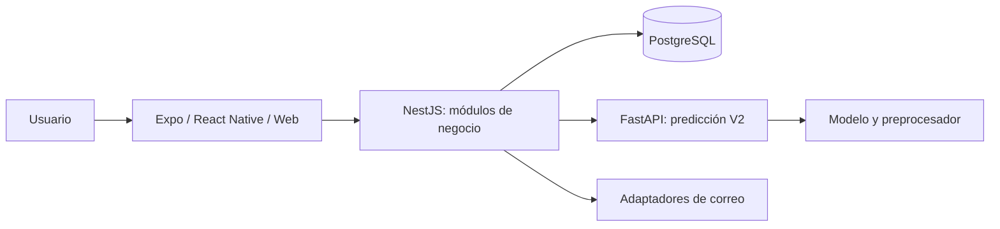

# Auditoría integral del sistema financiero

Fecha: **10 de noviembre de 2026**, America/Sao_Paulo. Carpeta auditada: `meu-sistema-financeiro`.

## 1. Dictamen

**El proyecto es un MVP avanzado en estabilización. Tiene una base arquitectónica aprovechable y bastante funcionalidad, pero todavía no reúne evidencia suficiente para considerarlo una versión de producción validada.**

Mi recomendación es continuar con la arquitectura actual: backend modular NestJS, frontend Expo/React Native y servicio ML independiente. La prioridad es consolidar el trabajo existente, recuperar una validación reproducible y cerrar los flujos de producto. Una reescritura o una división adicional en servicios aumentaría la carga de mantenimiento sin resolver los problemas observados.

La sostenibilidad es **razonable con estabilización y refactorizaciones puntuales**. Actualmente la reducen el volumen de cambios pendientes, la complejidad concentrada en planificación y sesiones, y la distancia entre una ejecución local y una entrega verificable. La capacidad para soportar una cantidad concreta de usuarios sigue sin medirse.

## 2. Alcance y fuerza de la evidencia

Se inspeccionaron estructura, módulos, rutas, persistencia, autenticación/sesiones, integridad financiera, cliente, ML, pruebas, manifiestos, configuración de CI, contenedores y documentación. Se ejecutaron tipos completos, Jest, lint sin autofix, compilación TypeScript de backend y exportación web.

Este informe distingue:

| Evidencia | Qué permite concluir |
| --- | --- |
| Ejecutada ahora | Resultado de una comprobación sobre la carpeta de trabajo actual. |
| Inspección estática | Comportamiento o riesgo visible en código; no equivale a reproducción con PostgreSQL. |
| Histórica | Resultado conservado en documentos o artefactos anteriores; no renueva la validación del código actual. |
| Pendiente | No acreditado en esta auditoría. |

No se ejecutaron migraciones ni se accedió a la base de la aplicación. No se iniciaron PostgreSQL, una instalación productiva, CI remota, envío de correo ni publicación. No hubo correcciones funcionales. Los builds y resultados de pruebas se guardaron en `.tmp/auditoria-2026-11-10/`.

No constituye un pentest, una certificación regulatoria ni un inventario actualizado de CVE de todas las dependencias. No se inspeccionaron valores de los `.env` reales. La revisión visual en dispositivos, accesibilidad, restauración productiva y carga quedan pendientes.

### Herramientas y límites del entorno

- Node no está disponible como comando normal; se utilizó el ejecutable existente del entorno, **Node 24.22.1**. La CI declara Node 22. Los resultados locales no sustituyen una instalación limpia bajo ese runtime.
- Git y npm no están disponibles como comandos. El estado local se inspeccionó leyendo referencias, objetos e índice de Git, sin modificarlos.
- El Python del entorno virtual apunta a `C:\Python314\python.exe`, que no existe. No fue posible ejecutar pytest.
- No hay herramientas GitNexus conectadas. El runner local falló porque no encuentra `npx`. Su índice declara el commit `c78636e`, anterior al HEAD actual y a cambios de trabajo; no se utilizó como grafo vigente.

## 3. Qué tiene el sistema

| Área | Implementación encontrada | Estado de validación |
| --- | --- | --- |
| Acceso y perfil | Registro, login, JWT, refresh con rotación, cambio/reset de contraseña, perfil y consulta de CEP. | Código y pruebas; correo real y recorrido completo actual pendientes. |
| Sesiones | Autoridad de sesión en PostgreSQL, vencimiento absoluto/inactividad, revocación, listado propio, reautenticación y coordinación del cliente. | Controles avanzados; aceptación remota/nativa actual pendiente. |
| Cuentas y categorías | Cuentas, saldos derivados, categorías por naturaleza, desactivación y referencias por propietario. | Implementado; existen pruebas unitarias y E2E como fuente. |
| Movimientos | Ingresos, gastos, transferencias, filtros, paginación y eliminación lógica. | Implementado; una prueba de repositorio falla por ordenación esperada. |
| Deudas y pagos | Deudas, pagos y vínculo con operaciones financieras. | Implementado; diferencias de contrato en pruebas del cliente. |
| Presupuestos y metas | Presupuestos mensuales, asignaciones por categoría, progreso, metas y alertas. | Implementado; integración actual con DB no ejecutada aquí. |
| Consultas | Dashboard, informes y auditoría consultable por usuario. | Implementado; sin prueba de carga. |
| Planificación compartida | Participantes, gastos, división, aciertos/liquidaciones y estados de cierre/cancelación/archivo. | Implementación extensa y pruebas; principal concentración de complejidad. |
| ML | FastAPI, contrato V2, features temporales, Random Forest, preprocesador, entrenamiento y evaluación. | Experimental; métricas conservadas de datos sintéticos. |
| Entrega | Dockerfiles backend/ML, migraciones SQL, seed demo, scripts de verificación y workflows. | Preparación existente; despliegue reproducible completo no acreditado. |

El [catálogo de requisitos](../produto/REQUISITOS.md) ya diferencia funcionalidad actual y futura. Pagos bancarios reales, Open Finance, invitaciones por token, carga real de comprobantes y publicación en tiendas figuran fuera del contrato actual. Su ausencia no impide cerrar el MVP financiero manual.

### Tamaño observado

- **18 controladores y 86 operaciones HTTP** detectadas estáticamente. Los pares método/ruta coinciden con las 86 operaciones de `backendnest/swagger.yaml`; esto no verifica todos los esquemas, códigos HTTP o comportamientos.
- **16 módulos funcionales del frontend**.
- **18 migraciones SQL**, de `0001` a `0018`; aplicación efectiva a una base desconocida.
- Aproximadamente **40.767 líneas de aplicación TypeScript/TSX/Python**, incluyendo comentarios y líneas vacías, en 484 archivos según el filtro usado: backend 213/16.508, frontend 256/23.338 y ML 15/921. Se excluyeron pruebas, declaraciones, dependencias y artefactos generados.
- 100 archivos unitarios seleccionados por Jest backend, 95 por Jest frontend, 37 archivos E2E backend y 9 archivos `test_*.py` de ML.

## 4. Por dónde va realmente

La rama local es `codex/frontend-architecture-incremental`, con HEAD **`43bcfac1817568d62ba7d1b0103468037cd4de6e`**. Los últimos commits locales incluyen precisión monetaria, naturaleza inmutable de categorías, actualización de transacciones y documentación de pruebas financieras.

La versión auditada incluye bastante trabajo posterior o adicional al commit:

- **159 archivos modificados y 1 ausente respecto al índice**, normalizando CRLF cuando corresponde.
- El índice reconstruido coincide con el árbol de HEAD: no se detectaron cambios staged en esa captura.
- **194 archivos adicionales no ignorados** dentro del inventario recorrido, aplicando los `.gitignore` inspeccionados: 90 backend, 76 frontend, 21 documentación, 1 workflow y 6 guías locales. Es una medición delimitada del inventario, no un `git status` que incluya exclusiones globales y todos los directorios ignorados.
- El archivo ausente es `frontend/src/modules/dashboard/components/DashboardShell.tsx`. Tipos y export web pasan con la estructura actual; la ausencia por sí sola no demuestra una rotura de ejecución.

Por tanto, **HEAD no representa por sí solo todo lo que se está usando**. Un despliegue construido desde ese commit puede omitir parte del trabajo de sesiones, cliente, pruebas y migraciones encontrado en disco. Antes de integrar o publicar hay que preservar y clasificar este trabajo por entregas coherentes.

Los documentos de U6/P4 describen preparación local y pruebas históricas delimitadas, manteniendo **P4 remoto abierto y producción bloqueada**. La documentación también distingue el cliente actual Expo 57 de un candidato P4 anterior con Expo 54. Una prueba del candidato anterior no valida automáticamente este frontend.

Fuentes: [resultado U6](SEGURANCA_SESSOES_ETAPA_2_U6_RESULTADO.md), [preparación P4](SEGURANCA_SESSOES_ETAPA_2_P4_CI.md), [auditoría anterior y seguimiento](AUDITORIA_ESTADO_ATUAL_SISTEMA_2026-10-15.md).

## 5. Comprobaciones ejecutadas ahora

| Comprobación | Resultado |
| --- | --- |
| Tipos backend completos: `tsc --noEmit --incremental false -p tsconfig.json` | **PASS**, exit 0. Incluye el ámbito completo configurado, no solamente el build. |
| Tipos frontend: `tsc --noEmit --incremental false` | **PASS**, exit 0. |
| Jest backend, sin caché, una ejecución | **1.079 PASS / 1 FAIL**, 1.080 pruebas; 99 suites pasan y 1 falla. |
| Jest frontend, sin caché, una ejecución | **838 PASS / 35 FAIL**, 873 pruebas; 80 suites pasan y 15 fallan. |
| Lint backend, reglas locales, `src/**/*.ts` y `test/**/*.ts`, sin fix | **1.555 errores / 140 avisos**, 374 archivos. 112 errores corresponden a runtime de `src` excluyendo specs; el resto se concentra especialmente en pruebas. |
| Lint frontend, ámbitos de aplicación, pruebas, configuración y scripts, sin fix | **70 errores / 78 avisos**, 380 archivos. El ámbito inicial de aplicación/pruebas tenía 63 errores; los scripts/configuración añadieron 7. |
| Compilación TypeScript backend con `tsconfig.build.json`, salida aislada | **PASS**, exit 0. No se construyó una imagen Docker. |
| Exportación estática Expo web, un worker, salida aislada | **PASS**, exit 0. Sin dotenv ni telemetría, en modo offline; no acredita una URL productiva configurada ni Android/iOS. |
| Coherencia entre manifiesto npm y dependencias raíz del lockfile | Sin divergencias detectadas en backend/frontend; lockfile v3. No es una instalación limpia ni un análisis de vulnerabilidades. |
| Pytest ML | **NO EJECUTADO**: entorno virtual no utilizable por ruta de Python ausente. |
| E2E PostgreSQL, harness CJS de sesiones, navegador contra API y pruebas nativas | **NO EJECUTADOS en esta auditoría**. Los resultados históricos conservan su alcance original. |

Los informes completos de Jest están en `.tmp/auditoria-2026-11-10/{backend,frontend}-jest.json`, junto con logs de pruebas y compilación. Las comprobaciones usaron las dependencias ya instaladas.

### Qué significan los fallos

El fallo backend compara la ordenación de transacciones: el código añade `id: DESC` para desempatar y el spec espera únicamente fecha/creación. La evidencia apunta a una expectativa desactualizada; hay que confirmar el contrato y preservar el desempate estable al corregir la prueba.

Los 35 fallos frontend se agrupan en **16 de navegación, 13 de reacción a sesión no autorizada y 6 del validador de pagos de deuda**. Hay evidencia concreta de mocks/expectativas antiguos: el mock de storage no configura el cleanup de `observeSessionLifecycle`, y las pruebas del validador no esperan el nuevo campo `fieldErrors`. Varias pantallas siguen esperando una llamada a `clearSession` que el helper de error ya no ejecuta.

Estos resultados no demuestran 35 defectos distintos en producción. Sí demuestran que la suite completa no valida de manera coherente el comportamiento actual. Las correcciones deben preservar las invariantes de sesión y autorización, no limitarse a quitar assertions.

Referencias: [spec de transacciones](../../backendnest/src/transacoes/repositories/transacao.repository.spec.ts), [repositorio](../../backendnest/src/transacoes/repositories/transacao.repository.ts), [pruebas de rutas](../../frontend/__tests__/navigation/protected-routes.test.ts), [RootLayout](../../frontend/src/navigation/RootLayout.tsx), [validador](../../frontend/src/modules/pagos-divida/validators/pagoDividaForm.ts).

## 6. Evaluación arquitectónica

### Lo que conservaría

1. **Monolito modular para el negocio financiero.** Los dominios tienen controladores, servicios, DTO, entidades y repositorios. Es una división comprensible para este producto y evita distribuir las transacciones financieras entre servicios. La organización por módulos está alineada con las [fronteras de módulos de NestJS](https://docs.nestjs.com/modules).
2. **PostgreSQL y migraciones con `synchronize: false`.** Existe control explícito del esquema, constraints e índices. La falta de prueba de aplicación no invalida la decisión tecnológica.
3. **Integridad ya trabajada.** Escrituras de transacciones con auditoría en la misma transacción, validación de propietario/estado y locks ordenados de cuentas; naturaleza de categorías inmutable; cálculos monetarios mediante centavos `bigint` y control de conversión de salida.
4. **Cliente por módulos y rutas finas.** Hay componentes compartidos, servicios tipados, validadores y un cliente HTTP central. `frontend/services/api.ts` es una reexportación del cliente compartido, no un segundo transporte independiente.
5. **ML tras el backend.** El cliente no consume directamente el servicio de predicción. El backend valida contrato/respuesta y aplica timeout; la indisponibilidad de predicción tiene una frontera propia.

### Dónde se está volviendo costosa

- `PlanejamentosService`: **2.353 líneas**. Acumula coordinación de participantes, gastos, aciertos y ciclo de vida. Ya existen cálculos en `domain/`; aprovecharía esa separación para extraer casos de uso gradualmente.
- `usePlanejamentoDetailMutations`: **1.042 líneas** y formulario de gasto: **1.038 líneas**. Hay demasiados estados, permisos y efectos que comprender para un cambio local.
- La abstracción de repositorio **no independiza completamente del ORM**: usa tipos TypeORM y los servicios reciben `EntityManager`/`DataSource`. Es una dependencia real que conviene aceptar y documentar; cambiar de ORM seguiría requiriendo trabajo en servicios.
- El transporte compartido importa coordinación del módulo auth. Es comprensible por la sesión, pero obliga a probar conjuntamente transporte, almacenamiento y autoridad. Evitaría agregar lógica de cada pantalla a esa frontera.
- Los contratos cliente/Swagger siguen mantenidos manualmente. Hoy las rutas coinciden; falta automatizar la comprobación de esquemas o generar tipos para reducir futuras divergencias.

Referencias: [AppModule](../../backendnest/src/app.module.ts), [repositorio base](../../backendnest/src/common/abstract/base.repository.ts), [servicio de planificación](../../backendnest/src/planejamentos/planejamentos.service.ts), [mutaciones de planificación](../../frontend/src/modules/planejamentos/hooks/usePlanejamentoDetailMutations.ts), [dinero](../../backendnest/src/common/money.util.ts), [escrituras de transacciones](../../backendnest/src/transacoes/transacoes.service.ts).

## 7. Hallazgos y prioridades

### A01 — Alta: la versión de trabajo no está consolidada

**Evidencia:** cambios y archivos adicionales descritos en la sección 4, incluyendo nueva migración `0018` y trabajo de seguridad. **Consecuencia:** perder trabajo en una limpieza, integrar una mezcla difícil de revisar o publicar un commit incompleto. **Acción:** preservar el estado, identificar qué pertenece a cada entrega y construir una baseline verificable. No hacer un commit masivo, reset o merge automático como respuesta a esta auditoría.

### A02 — Alta: comprobaciones de calidad fallan

**Evidencia ejecutada:** 1 fallo backend, 35 frontend y lint en ambas capas. Los tipos y builds pasan, por lo que hay una diferencia clara entre compilar y tener una regresión validada. La CI backend relaja tres reglas de tipos inseguros, pero incluso aplicando esa clasificación al runtime inspeccionado quedan 111 errores; esto es una clasificación estática de los resultados, no una ejecución remota del workflow. **Acción:** resolver por grupos de causa, sin desactivar pruebas ni relajar reglas globalmente para conseguir verde.

### A03 — Alta: registro de usuario y categorías sin transacción común

**Evidencia estática:** `AuthService.register` guarda al usuario en líneas 151–162 y después ejecuta `seedDefaultCategories` en la 164. Los repositorios usan operaciones separadas y no reciben un mismo manager en ese recorrido. Si falla el segundo paso, puede quedar un usuario creado aunque el registro devuelva error; un reintento encuentra duplicado. **Acción:** definir un alta atómica o un proceso explícito recuperable/idempotente y verificar fallo intermedio/concurrencia con PostgreSQL. Si se elige transacción, todas sus escrituras deben usar el [mismo manager transaccional](https://typeorm.io/docs/transactions/).

Referencia: [registro](../../backendnest/src/auth/auth.service.ts), [categorías](../../backendnest/src/categorias/categorias.service.ts), [persistencia](../../backendnest/src/categorias/repositories/categoria.repository.ts). El caso no se reprodujo contra una DB durante esta auditoría.

### A04 — Alta para continuidad: entorno poco reproducible

**Evidencia:** comandos Git/npm/Node ausentes, Python virtual con ruta rota y versiones distintas entre local/CI/contenedores. **Acción:** declarar y preparar un runtime de desarrollo consistente con la CI, reconstruir el virtualenv desde la ubicación actual y documentar un bootstrap. El uso del Node incorporado al entorno permitió auditar, pero no debería ser el procedimiento normal del proyecto.

### A05 — Alta para una entrega pública: faltan pruebas operativas actuales

**Evidencia:** existen Dockerfiles, pero no un Compose del stack ni un workflow de despliegue identificado en los archivos inspeccionados. No se acreditaron destino, rollback, restauración, secretos ni alertas operativas. `/health` devuelve un objeto estático y no comprueba DB u otras dependencias: no sirve como prueba suficiente de readiness. **Acción:** un entorno de ensayo reproducible, checks de disponibilidad apropiados, backup/restauración y rollback medidos antes de una entrega pública. La ausencia en el repo no prueba que no exista infraestructura externa.

Referencia: [health](../../backendnest/src/app.service.ts), [Docker backend](../../backendnest/Dockerfile), [Docker ML](../../ml-finance-tcc/Dockerfile), [runbook](../operacao/RUNBOOK.md).

### A06 — Media/alta: complejidad concentrada en planificación

**Evidencia:** tamaños anteriores y errores lint en acceso a refs durante render/efectos, especialmente en hooks de planificación. `reactCompiler` está activado en `app.json`. **Acción:** después de asegurar pruebas de comportamiento, extraer participantes, gastos, aciertos y transiciones en cambios pequeños, con análisis de impacto y contratos estables. Un lint de hooks es señal para revisar la semántica, no prueba automática de un bug visible.

### A07 — Media, antes de crecer: coste de saldos y sesiones sin medir

**Evidencia estática:** para saldos se cargan movimientos y transferencias en memoria y se recorren por cuenta; el coste crece con historial y número de cuentas. La autorización de sesión adquiere locks de usuario y sesión, y las peticiones con actividad actualizan la sesión. **Consecuencia posible:** presión de memoria, consultas costosas y contención por usuario. No se midió capacidad ni latencia. **Acción:** medir primero; después considerar agregaciones SQL precisas y revisión de consultas/índices. No introducir caché de saldos sin reglas explícitas de coherencia.

Referencias: [saldos](../../backendnest/src/contas/contas.service.ts), [lectura de movimientos](../../backendnest/src/contas/repositories/conta.repository.ts), [autoridad de sesión](../../backendnest/src/auth/repositories/auth-session.repository.ts), [locks](../../backendnest/src/auth/repositories/credential-lock.ts).

### A08 — Media/alta para producto: correo real sin acreditar

**Evidencia:** existe adaptador HTTP de recuperación de contraseña; su entrega efectiva no se verificó. El worker de aviso de contraseña cambiada es explícitamente de desarrollo y rechaza modo live. **Acción:** cerrar la integración de cada flujo con proveedor de ensayo, observar fallo/reintento y verificar que el usuario recibe y puede usar el enlace. Tener outbox/adaptador no demuestra entrega.

Referencias: [recuperación](../../backendnest/src/auth/password-reset-delivery.service.ts), [configuración de avisos](../../backendnest/src/auth/notifications/password-changed.config.ts).

### A09 — Media: seguridad web y móvil requieren aceptación diferenciada

**Evidencia:** SecureStore nativo y `localStorage` web; coordinación web exige contexto seguro y Web Locks. Los tokens web siguen accesibles a JavaScript: un XSS tendría consecuencias sobre la sesión, aunque no se identificó aquí un XSS explotable. [OWASP desaconseja guardar identificadores de sesión en localStorage](https://cheatsheetseries.owasp.org/cheatsheets/HTML5_Security_Cheat_Sheet.html#local-storage). **Acción:** definir el alcance web y su modelo de amenazas; evaluar cookies HttpOnly/BFF y protecciones CSRF cuando corresponda, junto con CSP y control de scripts. Cualquier cambio necesita preservar el contrato móvil. Validar logout, refresh, suspensión/reanudación, reinstalación y recuperación en dispositivos reales. No hay `eas.json` ni entrega instalable acreditada en el inventario.

Referencia: [storage](../../frontend/storage/authStorage.ts), [autoridad](../../frontend/src/modules/auth/services/sessionAuthority.ts), [configuración Expo](../../frontend/app.json).

### A10 — Media: ML experimental y entorno de modelo sin congelar

**Evidencia histórica:** `metrics.json` declara **630 filas sintéticas, 30 usuarios**, accuracy 82,67%, recall 67,21% y F1 75,93%. La baseline de persistencia tiene recall 75,41%: el modelo mejora otras métricas, pero identifica menos déficits en ese conjunto de prueba. No hay prueba de generalización a usuarios reales.

Hay split temporal y preprocesador ajustado en train, decisiones correctas. Faltan criterio de producto, evaluación representativa, calibración y seguimiento de drift. `requirements.txt` permite intervalos amplios y el manifiesto de modelo no conserva todas las versiones ni hashes de entrenamiento. El uso de joblib/pickle exige artefactos confiables y un entorno compatible, como advierte la [documentación de persistencia de scikit-learn](https://scikit-learn.org/stable/model_persistence.html).

**Acción:** mantener la predicción como experimental y opcional mientras se cierra el núcleo financiero; fijar dependencias/identidad del modelo y decidir qué error de predicción se quiere minimizar antes de ampliar su uso.

Referencias: [métricas](../../ml-finance-tcc/reports/metrics.json), [entrenamiento](../../ml-finance-tcc/ml/training.py), [pipeline](../../ml-finance-tcc/main.py), [artefactos](../../ml-finance-tcc/persistence/model_repository.py).

### A11 — Media: documentos y validaciones describen estados diferentes

El roadmap de profesionalización todavía enumera falta de Dockerfiles y ausencia de CI ML/E2E, aunque esos archivos ya existen. La documentación frontend mantiene referencias al shell anterior. Los documentos U6 conservan historia útil, pero sus resultados pertenecen a candidatos diferentes. **Acción:** mantener un único estado actual con enlaces a evidencia histórica y actualizar el backlog; conservar los históricos con su fecha y alcance.

Referencias: [roadmap](../produto/ROADMAP_PROFISSIONALIZACAO.md), [arquitectura frontend](../arquitetura/FRONTEND.md), [CI](../../.github/workflows/ci.yml).

### A12 — Media: validación automática todavía fragmentada

La CI general declara frontend, backend, E2E PostgreSQL 16 y ML. La suite Jest de backend selecciona `src/**/*.spec.ts`; no selecciona automáticamente el harness CJS de sesiones. Existe un workflow P4 manual específico, pero no se ejecutó ni se verificó su resultado remoto aquí. **Acción:** definir una matriz de checks obligatorios para cada entrega, incluyendo los checks puros de sesiones y tipos completos relevantes, y vincular su resultado al mismo candidato que se entregará.

## 8. Qué ya mejoró respecto a problemas anteriores

No se mantienen como defectos actuales los problemas anteriores solo porque estén escritos en un informe:

- El parser monetario actual trata agrupamientos repetidos; las pruebas existentes de ese ámbito pasaron en la suite frontend.
- La categoría rechaza un cambio de naturaleza mediante `CATEGORIA_TYPE_IMMUTABLE`.
- Las transacciones guardan auditoría dentro de su transacción.
- Saldos, presupuestos y agregados incorporan utilidades de centavos exactos.
- Hay paginación acotada en transacciones y trabajo actual de intención/idempotencia en transferencias, con migración `0018`.
- Los tipos completos del backend ahora pasan; un bloqueo histórico de tipos no debe seguir presentándose como vigente.

La idempotencia de transferencias es un avance localizado; no demuestra una política general de repetición segura para cualquier escritura financiera. La aplicación efectiva de su migración y las carreras contra PostgreSQL deben validarse sobre la baseline elegida.

## 9. Por dónde comenzaría

| Orden | Entrega concreta | Criterio para darla por terminada |
| --- | --- | --- |
| 1 | Preservar/clasificar WIP y recuperar entorno reproducible. | Fuentes y migraciones identificadas; comandos disponibles; Python utilizable; ejecución desde esta carpeta sin rutas antiguas. |
| 2 | Cerrar la regresión actual. | Pruebas unitarias y lint acordados pasan; mocks representan la sesión real; no hay assertions retiradas para ocultar errores. |
| 3 | Cerrar integridad de alta y validar finanzas con DB descartable. | Alta completa o recuperable sin cuenta parcial; migraciones 0001–0018 y E2E relevantes pasan; reintentos/concurrencia de transferencias comprobados. |
| 4 | Reducir complejidad de planificación por casos de uso. | Cambios pequeños con el mismo comportamiento, cobertura y análisis de impacto; tamaños reducidos sin nueva abstracción vacía. |
| 5 | Calificar una entrega de producto. | CI del candidato actual, instalación/recorrido en plataformas elegidas, correo de ensayo, health/readiness, backup/restauración y rollback verificados. |
| 6 | Medir escala y madurar ML según necesidad. | Objetivos de capacidad definidos y medidos; ML supera la baseline elegida sobre evaluación representativa y tiene entorno/artefactos reproducibles. |

La primera tarea funcional que tomaría después de asegurar el estado de trabajo sería **cerrar la validación de sesión/navegación y el alta de usuario**. Son recorridos de entrada de los que depende todo lo demás. La refactorización grande de planificación se beneficia de tener esa base estable antes.

## 10. Sostenibilidad y criterio de salida

| Dimensión | Evaluación |
| --- | --- |
| Elección tecnológica | Coherente y aprovechable. Dos ecosistemas de ejecución requieren disciplina de versiones. |
| Organización del negocio | Buena base modular; planificación necesita límites menores. |
| Integridad de datos | Controles relevantes y mejoras recientes; falta revalidación integrada actual y cierre del alta. |
| Calidad automatizada | Cobertura extensa en cantidad, pero suite/lint aún no están verdes. No se midió cobertura de código. |
| Operación y entrega | Preparación considerable; reproducibilidad y pruebas de entrega todavía insuficientes. |
| Escalabilidad | Potencial razonable para una primera versión; capacidad concreta desconocida. |
| ML | Valor académico/experimental; valor predictivo real pendiente. |

Consideraría cerrada una primera versión mantenible cuando pueda instalarse desde una fuente identificada, levantar sus dependencias de forma documentada, ejecutar checks obligatorios, completar los recorridos financieros y de sesión, y recuperarse de un fallo con procedimientos probados. No asigno un porcentaje de avance: faltan un alcance de aceptación aprobado y una validación integral actual que permitan calcularlo con sentido.
